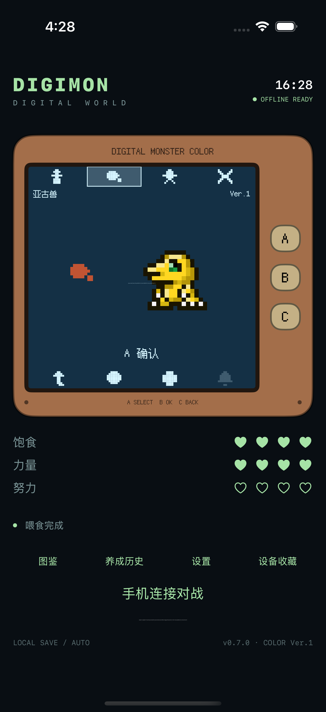
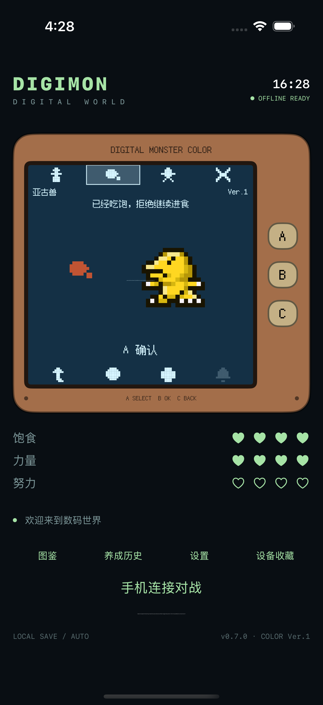
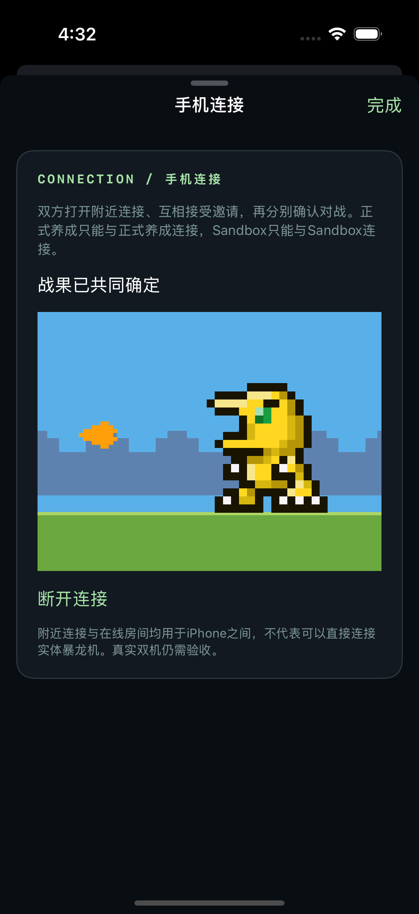

# DIGIMON · DIGITAL WORLD

原生 iOS 17 像素电子宠物工程，使用 SwiftUI、SpriteKit 与独立 Swift 游戏核心。**v0.8 默认以 Digital Monster COLOR Ver.1 为基准：彩色养成＋8区顺序闯关。** 角色采用原版彩色像素归档图集，设置可自由切换复古彩色、高级彩色和经典灰绿色 LCD，并保存选择。

v0.7加入COLOR Ver.2、跨Ver.1/Ver.2联展、四语显示和云盘设备合集，并修复喂食画面遮挡。侧装用户可通过自托管中继使用在线房间，无需加入Apple开发者计划。[在线房间搭建说明](Server/README.md) · [战斗与主页动作](Documentation/BATTLE_PRESENTATION.md)

v0.8 支持从 Files 导入有使用权限的音频、按机型选择三种音频模式和分别调节各频道。运动训练支持手机计步、摇晃、倾斜和虚拟按键。[音频包格式与操作说明](Documentation/ORIGINAL_AUDIO.md)

隐藏的本机开发测试面板现只修改独立Sandbox，可指定已收录角色、发放道具、修改数值，并自动保留调试前快照。功能范围见[开发测试说明](Documentation/DEVELOPER_TOOLS.md)。

目前是开发版本，未完成最初需求中的全部阶段。操作依据官方说明书，隐藏数值参考社区实测；资料分歧和待验证部分见 [规则出处](Documentation/RULE_SOURCES.md)。

## 模拟器实测截图

以下为v0.7在iPhone 16 Pro模拟器（iOS 18.5）的实测截图，展示进食、拒食及通过真实中继连接的房间对战。

<p>



</p>

v0.8 通过了 91 项核心、22 项界面、4 项中继测试及 Debug/Release 编译。[实测记录与剩余验收范围](Documentation/VALIDATION.md)

## 下载IPA

已发布 v0.8.0 侧装测试包，包含 COLOR Ver.2、音频资源库及手机运动训练。历次版本可在发布页查看。

[下载 v0.8.0 未签名 IPA](https://github.com/whodaregg/digimon-digital-world-ios/releases/download/v0.8.0/DigitalWorld-v0.8.0-unsigned.ipa) · [发布页与校验文件](https://github.com/whodaregg/digimon-digital-world-ios/releases/tag/v0.8.0)

文件大小为 6,948,743 字节，SHA-256 为 `4c06d255282076fd4a0e1ff84de397a12c21c08eadea3cf893d03593dbe80b94`。

适用于真机arm64、iOS17及以上。安装包尚未签名，需要使用自己的签名工具与签名资料签名后安装，不能直接点开安装。发布页的Source code压缩包为源码，安装请下载`.ipa`文件。

真机SDK编译、平台/架构、包结构与下载后的SHA-256已通过校验；实际iPhone签名安装仍待验收。后续打包可在Actions手动运行“打包真机IPA”，已存在的版本不会被覆盖。

## 在 Xcode 运行

1. 克隆仓库，用 Xcode 16 或更新版本打开 `DigitalWorld.xcodeproj`。
2. 选择 **DigitalWorld** scheme 和 iPhone/iPad 模拟器，按 **Run**。
3. 在欢迎页孵化 Ver.1 数码蛋，约8秒后诞生。应用关闭后再打开会结算离线时间。

Swift Package 位于仓库内，无第三方库依赖。真机需在 Signing & Capabilities 选择自己的开发团队和唯一 Bundle ID；仓库不包含签名证书或已签名 IPA。

## 当前玩法

- 四颗饱食心、四颗力量心、努力、年龄、体重、DP与通算胜率。
- 肉和蛋白质；A上段/B下段五次攻击训练，命中至少三次成功；完整失败训练也计入努力与进化条件。
- 按角色作息睡眠、关灯、睡眠打扰、Cold暂停成长、一只伙伴备份交换、清洁和多次治疗。
- 照顾失误、训练、满腹、睡眠打扰与战绩决定进化；包含Ver.1的17种养成角色。
- Quest按AREA 1～7、F顺序解锁；每区固定3～5个敌人，连续战斗，先命中三次获胜。失败需从本区首战重来，每次整区消耗1DP、减重6g。
- Alter-S作为最终区敌人收录；手机通信适配已接入，真实双机仍待验收，已支持与Ver.2指定角色联展。
- 原版角色像素、三种显示模式、可解锁的重绘背景主题、A/B/C按键与触屏快捷操作。
- 图鉴、中文规则说明、成长日志、本地自动存档与损坏恢复、v1/v2/v3/v4旧档兼容、验证后的文件导入与导出。

原味界面已移除平面上下左右探索。旧版实验存档继续按旧规则读取，可在设置中“备份旧档并开始 Ver.1”；切换前会另存完整旧档，显示设置会保留。设置中可直接恢复或导出切换前档案。

## 验证

```sh
swift test
python3 Scripts/build_content.py
python3 Scripts/validate_assets.py
python3 Scripts/generate_project.py
python3 Scripts/validate_project.py
git diff --exit-code
```

macOS原生验证：

```sh
xcodebuild test -project DigitalWorld.xcodeproj -scheme DigitalWorld \
  -destination 'platform=iOS Simulator,name=iPhone 16' CODE_SIGNING_ALLOWED=NO
```

模拟器名称按 `xcrun simctl list devices available` 调整。运行全套界面测试前需启动本机中继及原生测试对手，启动命令见 `ios.yml` 的 `Start native room integration peer` 步骤。GitHub Actions会自动启动它们。[验证工作流](.github/workflows/ios.yml) · [实测记录](Documentation/VALIDATION.md)

[28项需求落实与依赖清单](Documentation/FEATURE_STATUS.md)列出已接入功能、未实现模块和需要真实设备/账号配置的部分；它们不等于全部世代已完成。

## 工程与资料

| 目录 | 内容 |
| --- | --- |
| `Sources/DigitalWorldCore/DeviceRules` | Ver.1和Ver.2独立规则、时间/养成/训练/Quest与数据模型 |
| `Sources/DigitalWorldCore/Resources` | 版本化内容、规则JSON、原始角色PNG及出处哈希 |
| `Sources/DigitalWorldCore` 其余目录 | 旧规则兼容、公共模型、存档、素材读取 |
| `iOS` | SwiftUI界面、SpriteKit像素显示、声音、触觉、本地通知 |
| `Server` | 两人房间中继、测试与部署文件 |
| `Tests`, `iOSUITests` | 确定性核心测试与模拟器交互测试 |
| `Scripts` | 内容、素材校验与Xcode工程生成 |

- [中文更新记录](CHANGELOG.md)
- [规则出处与分歧](Documentation/RULE_SOURCES.md)
- [角色像素出处](Documentation/SPRITE_CREDITS.md)
- [范围与未完成功能](Documentation/STATUS.md)
- [真机验收清单](Documentation/DEVICE_CHECKLIST.md)

这是非官方开发工程。角色PNG保留归档原始字节，没有用自绘或生成角色冒充原版。原始素材与权利状态详见出处文档，归档来源不等于官方发行授权。
